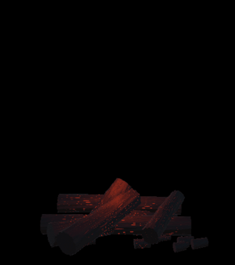

# Breath Bonfire — 息で育つ焚き火

USBマイクへの息の音量で、薪から炎がゆっくり育ち、入力を止めると熾火へ戻るUnityの展示作品です。

炎は、GPUで解く小型の3D流体（速度・圧力・燃焼量・温度）の結果をレイマーチで描画します。柱や輪郭を持たず、形はすべて燃焼量の等値面から決まります。薪は手続きメッシュとURP PBRシェーダー、火の粉はParticle Systemです。外部の画像素材やモデルなしでシーンを生成できます。

**最新の調整：固定の7本の柱をやめ、炎全体を一つの流体として解く方式に置き換えました。** 内容は[流体の炎への変更](流体の炎への変更.md)を参照してください。[USBマイクの周囲音対策](USBマイクの周囲音対策.md)も同梱しています。

**現段階は制作途中です。参考写真と同等の実写品質を検証した完成品ではありません。** 実際の描画と未確認事項は[検証結果](検証結果.md)を参照してください。

成長・維持・減衰の通しの連続フレームです（15fpsのオフライン確認用。実機速度の測定ではありません）。以前の版の記録もVerification内に残しています。



## 使用環境

- Windows / Unity **6000.4.4f1**
- Universal Render Pipeline **17.4.0**
- Input System **1.19.0**
- USBマイク（なくてもSpaceキーで確認可能）

## 開き方

1. このリポジトリをクローンするか、GitHubの **Code → Download ZIP** からダウンロードして展開します。
2. Unity Hub → **Projects → Add project from disk** で、リポジトリ内の **BonfireUnity** フォルダを選びます。リポジトリの最上位やAssets自体は選びません。
3. Unity 6000.4.4f1で開き、パッケージの取得を待ちます。
4. Unityメニューの **Tools → Interactive Bonfire → Generate Scene** を実行します。生成先のシーンを置き換えるため、個別調整したシーンは先に別名保存してください。
5. **Play** → Game画面をクリック → **Spaceを長押し**します。

マイクは実行中のBonfire RigのBreath Microphoneで選択・調整できます。初期状態では薪と熾火だけが見えます。

## 操作と現在の設定

|操作・設定|内容|
|---|---|
|Space長押し|息を吹く入力を代用|
|Manual Breath|Inspectorから0〜1で入力|
|F3|診断表示の切り替え|
|Growth Seconds|9|
|Decay Seconds|12|
|Maximum Growth Per Second|0.11|

強い入力を保つと約12〜14秒で最大付近へ近づき、最大火力から入力を止めると約22秒で熾火へ戻る設定です。

## 日本語ガイド

- [導入・マイク設定・画質調整・Windowsビルド](はじめに_日本語.md)
- [速度調整と設定の保存](速度調整版の使い方.md)
- [検証結果と現段階の課題](検証結果.md)
- [流体の炎への変更](流体の炎への変更.md)
- [旧版の形と今回の立ち上がりを組み合わせた調整](形と立ち上がりの調整.md)
- [同梱設定と依存パッケージについて](THIRD_PARTY_NOTICES.md)

## ソースの配置

```text
BonfireUnity/
  Assets/InteractiveBonfire/
    Runtime/       マイク・火力制御・薪とエフェクトの生成
    Shaders/       炎・薪・火の粉のシェーダー
    Resources/     密度・温度を更新するCompute Shader
    Editor/        シーン生成・品質メニュー・開発用検証
    Generated/     シーン・マテリアル・ポスト処理
  Assets/Settings/ URP設定
  Packages/        パッケージの依存関係
  ProjectSettings/ Unityプロジェクト設定
  Verification/    実際のUnity描画画像と以前の検証記録
```

`Library`、`Temp`、`Logs`、`UserSettings`、配布ZIP、作業用テンプレートはGitの対象外です。Unityが必要なキャッシュを初回起動時に再生成します。

## 確認範囲

流体版はUnityでC#・シェーダーのコンパイル、成長・維持・減衰の連続描画、Windowsビルドの作成を確認しています。Playでの通し操作、USBマイクの実入力、プロジェクター投影、実機での1080p/60fpsは未検証です。

参考写真・参考動画のデータはリポジトリに含めていません。
